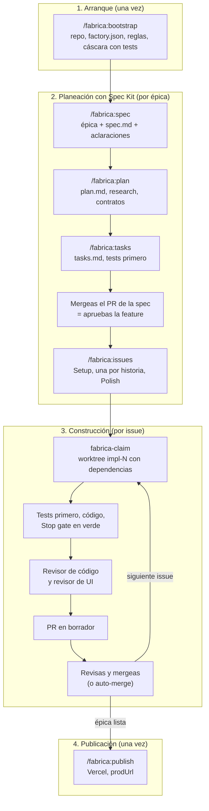
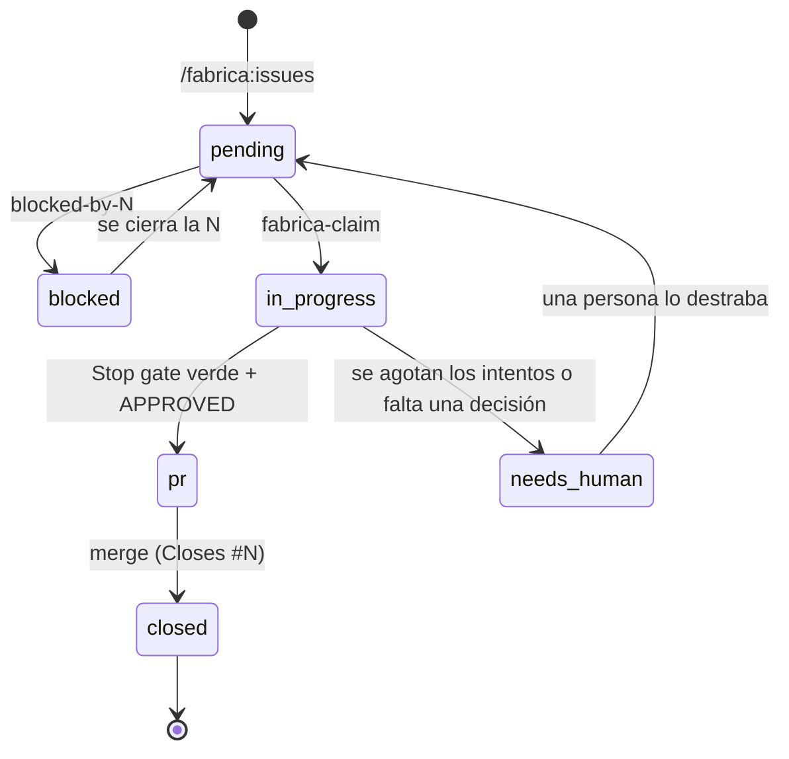

# El flujo de la fábrica

Cómo pasa una idea a código mergeado y publicado, qué parte de eso hace Spec
Kit, y las distintas formas de poner a trabajar a la fábrica. Para los
comandos paso a paso, el [manual](MANUAL-DE-LA-FABRICA.md); para el detalle
de cada pieza, la [guía](GUIA-DE-LA-FABRICA.md).

## El flujo completo

Hay cuatro etapas. Las dos primeras se hacen contigo en una sesión; la
tercera puede correr sola; la cuarta se hace una vez.

1. **Arranque.** `/fabrica:bootstrap` deja el proyecto listo para trabajar:
   `factory.json` (comandos, modelos, idioma), `CLAUDE.md`, las reglas en
   `.factory/`, los workflows, las etiquetas y una cáscara mínima con sus
   tests. Termina en tu idea escrita (`docs/brief.md` o `docs/srd.md`) y no
   programa nada más.
2. **Planeación.** Por cada épica, Spec Kit escribe qué se construye, cómo y
   en qué orden, en un PR en borrador que tú apruebas mergeándolo. Después,
   `/fabrica:issues` lo convierte en una cola de issues encadenadas.
3. **Construcción.** Cada issue se trabaja en su propia carpeta (worktree),
   con los tests primero, y no termina hasta que pasa el Stop gate y los
   revisores dicen APPROVED. El resultado es un PR que mergeas tú, o que se
   mergea solo si la issue tiene `auto-merge`.
4. **Publicación.** `/fabrica:publish` conecta el repo al hosting y prueba
   producción. Después, cada push a `main` publica solo.

## Spec Kit dentro de la fábrica

[Spec Kit](https://github.com/github/spec-kit) es la herramienta de GitHub
para escribir specs. La fábrica trae su versión 1.2.2 dentro del plugin y la
usa solo para planear: construir es trabajo de la fábrica.

**Cómo llega al proyecto.** `fabrica-setup speckit` arma `.specify/` en cada
máquina, a partir del plugin. Esa carpeta no se commitea (va al
`.gitignore`), y se rehace sola cuando cambia la versión del plugin, de Spec
Kit o el perfil del stack. Trae:

- los comandos de Spec Kit en `.specify/commands/`, que las skills de la
  fábrica leen y siguen (no son skills sueltas, para que el modelo no los
  cargue por su cuenta);
- la **constitución** en `.specify/memory/constitution.md`, escrita con las
  reglas de la fábrica y el perfil del stack;
- la plantilla de tareas de la fábrica, que hace obligatorios los tests.

**La constitución** tiene cuatro principios que el plan tiene que cumplir:

| Principio                               | Qué exige                                                                             |
| --------------------------------------- | ------------------------------------------------------------------------------------- |
| I. Test primero                         | Cada historia trae sus tests antes que su implementación. No se negocia.              |
| II. Historias que se entregan solas     | Cada historia se construye y prueba por separado; lo común va en Setup.               |
| III. La spec aprobada no cambia en obra | Mientras se construye, `specs/` no se toca; si falta algo, la issue va a una persona. |
| IV. El perfil del stack manda           | El plan sigue `.factory/rules/stacks/<stack>.md`, o justifica por qué no.             |

**Qué paso usa qué comando:**

| Paso de la fábrica | Comando de Spec Kit                   | Deja                                                                     | Lo que agrega la fábrica                                                                                        |
| ------------------ | ------------------------------------- | ------------------------------------------------------------------------ | --------------------------------------------------------------------------------------------------------------- |
| `/fabrica:spec`    | `speckit-specify` y `speckit-clarify` | `specs/<N>-<nombre>/spec.md`                                             | Crea la épica (con tu OK), numera la carpeta con ella, la rama `spec-<N>`, el plan maestro y el PR en borrador  |
| `/fabrica:plan`    | `speckit-plan`                        | `plan.md`, `research.md`, `data-model.md`, `contracts/`, `quickstart.md` | El Constitution Check contra los cuatro principios, y la versión de la fábrica con que se planeó                |
| `/fabrica:tasks`   | `speckit-tasks`                       | `tasks.md`                                                               | Revisa tests primero, que cada criterio tenga tarea, y que dos historias en paralelo no toquen el mismo archivo |
| `/fabrica:issues`  | ninguno                               | issues en GitHub                                                         | Setup, una por historia y Polish, con `blocked-by-N`, sub-issues de la épica y tu OK antes de crear nada        |

Si no quedan dudas, `/fabrica:spec` encadena solo el plan y las tareas en la
misma sesión. `/fabrica:issues` siempre lo pides tú, después del merge.

**Durante la construcción.** El worker corre `fabrica-spec-context N`, que le
da los archivos de la spec, las tareas de su issue y, si es una historia,
sus escenarios de aceptación. Las tareas son su guía, en orden y con el test
primero, y los escenarios son criterios de aceptación. El worker nunca edita
`specs/` (el Stop gate lo bloquea) ni corre `speckit-implement` u otro
comando de Spec Kit. Si la spec no alcanza, la issue va a `needs-human`: la
spec aprobada solo la cambia una persona.

**Sin Spec Kit.** Una tarea suelta, un bug o un incidente no necesitan spec:
`/fabrica:write-ticket` escribe una issue completa (criterios, tests
esperados, qué queda fuera) y el worker la trabaja con el cuerpo de la issue
como único ticket.

## Las formas de usarla

Las cuatro primeras trabajan las mismas issues con el mismo ciclo, el mismo
Stop gate y los mismos revisores; cambia dónde corre y quién mira.

| Forma           | Cómo se arranca                                      | Dónde corre                             | Quién mira                               | Modelo que escribe el código | Cuándo conviene                                              |
| --------------- | ---------------------------------------------------- | --------------------------------------- | ---------------------------------------- | ---------------------------- | ------------------------------------------------------------ |
| En tu sesión    | `/fabrica:backlog` (o `/fabrica:backlog N`)          | Tu computador, una issue por llamada    | Tú, en vivo                              | El de tu sesión              | Para empezar, y para issues delicadas                        |
| Workers locales | `fabrica-backlog` (o pedírselo a `/fabrica:backlog`) | Tu computador, un `claude -p` por issue | Nadie; revisas los PRs después           | `models.worker`              | Para vaciar la cola sin estar mirando                        |
| Dev container   | `fabrica-backlog` dentro del contenedor              | Un contenedor con firewall              | Nadie; sin preguntas de permisos         | `models.worker`              | Para workers con `bypassPermissions`, aislados de tu máquina |
| La nube         | Etiqueta `ready-for-dev` en una issue                | GitHub Actions, una issue por corrida   | Nadie; tu computador puede estar apagado | `models.worker`              | De noche, o desde el celular                                 |
| Menciones       | Comentario `@claude ...` en una issue o PR           | GitHub Actions                          | Tú, en el hilo                           | El de la acción              | Preguntas y cambios puntuales; nunca para planear            |

Docker es opcional: solo lo necesita el dev container. Sin él, los workers
locales corren en tu computador con permisos `auto`, que a veces niegan un
comando. Cómo se usa cada forma y cómo se combinan está en la
[guía](GUIA-DE-LA-FABRICA.md), Parte 3.5.

Algunas reglas que valen para todas:

- **Asignar es reservar.** Una issue asignada a otra persona no la toma
  nadie más, ni la nube. `ready-for-dev` es el carril de la nube: tu
  computador se la salta.
- **Carriles.** `/fabrica:backlog solo el carril area:billing` o
  `solo lo asignado a mí` reparten la cola entre personas.
- **Planear siempre es en sesión.** `spec`, `plan`, `tasks`, `issues` y
  `publish` se niegan a correr en un worker o en una mención.
- **Un worker nunca mergea**, no empuja a `main` ni fuerza un push: lo
  bloquea un hook. Con `auto-merge`, mergea el orquestador después de
  esperar los checks.

## La vida de una issue

- **`pending`**: en la cola. Con `blocked-by-N`, espera a que se cierre la
  issue N; la etiqueta se va sola.
- **`in-progress`**: un worker la tomó y trabaja en `impl-N`.
- **PR en borrador**: el trabajo terminó. Si cambió la pantalla, las
  capturas pasan por ti (ver el manual, "Capturas visuales").
- **`needs-human`**: el worker se rindió y dejó un comentario con lo que
  falta. Se retoma devolviéndola a `pending`.
- **Cerrada**: el merge del PR la cierra y desbloquea las que esperaban.

## Lo que cuida la calidad

| Pieza             | Cuándo actúa                            | Qué hace                                                                                                   |
| ----------------- | --------------------------------------- | ---------------------------------------------------------------------------------------------------------- |
| Constitución      | Al planear                              | El plan no pasa si rompe un principio sin justificarlo                                                     |
| Stop gate         | Cada vez que el worker intenta terminar | Corre lint, tipos, tests, build y e2e de `factory.json`; si algo falla, no lo deja parar                   |
| Revisor de código | Antes del PR, hasta 3 rondas            | Lee solo la issue y el cambio; cada hallazgo con archivo, línea y severidad; APPROVED sin Blocker ni Major |
| Revisor de UI     | Si la issue tiene `ui-review`           | Mira capturas en tres anchos contra el diseño o `design-system.md`                                         |
| Job visual del PR | En cada PR                              | Compara las capturas; una persona decide si el cambio queda                                                |
| `worker-guard`    | Siempre, en un worker                   | Bloquea merge, push a `main` y push forzado                                                                |
| Tú                | Al aprobar la spec y al mergear cada PR | Las dos decisiones que la fábrica nunca toma sola                                                          |
