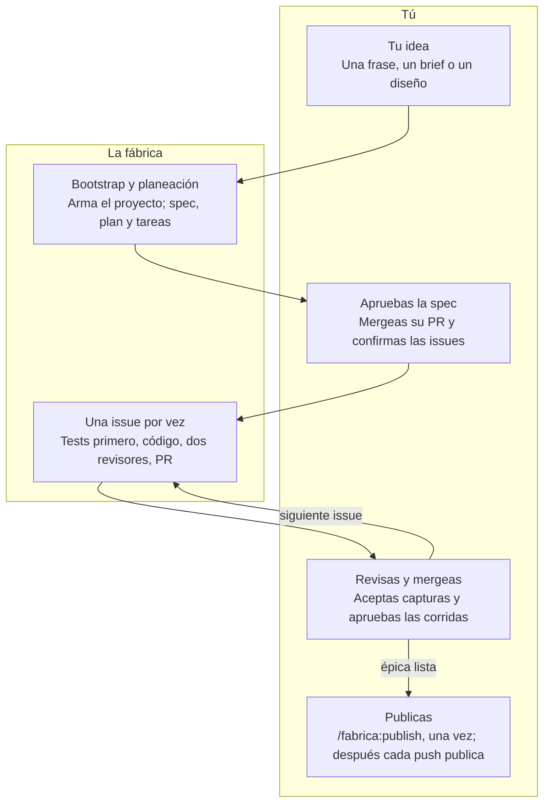

# Manual de la Fábrica

La fábrica es un plugin de Claude Code que convierte una idea en software
revisado y mergeado: tú decides qué se construye y apruebas el resultado, y
ella planea, programa, prueba y revisa. Este manual cubre la versión 0.5.20 y
lo aprendido al clonar y publicar un sitio real (el portafolio de
REFASTIDIOSO). El detalle de cada pieza está en
[`GUIA-DE-LA-FABRICA.md`](GUIA-DE-LA-FABRICA.md), y el flujo completo con
Spec Kit, en [`FLUJO-DE-LA-FABRICA.md`](FLUJO-DE-LA-FABRICA.md).

## Cómo funciona

Tú decides en cuatro momentos; la fábrica hace lo demás.



Tu trabajo se concentra en aprobar la spec y en revisar cada PR; entre
medio, la fábrica repite su vuelta una issue tras otra hasta vaciar la cola.

## Una vez por computador

Se hace una sola vez y sirve para todos tus proyectos.

1. Instala **git**, **node**, **gh**, **jq** y **claude** (Claude Code). En
   Windows, usa Git Bash como terminal.
2. Entra a GitHub con `gh auth login` y a Claude con `claude`.
3. Registra el marketplace del plugin:
   `claude plugin marketplace add <URL o ruta de fabrica-plugin>`.
4. Saca el token de la nube con `claude setup-token` y guárdalo en un gestor
   de contraseñas. Lo usan las menciones `@claude` y la etiqueta
   `ready-for-dev`.
5. Instala una vez la GitHub App de Claude: github.com/apps/claude, Install,
   All repositories.

Si un programa recién instalado "no se reconoce", abre una terminal nueva.

## Proyecto nuevo

La fábrica arranca proyectos de Node y TypeScript, con cualquier framework
(Vite, Next, Express, una CLI). Python y Go todavía no.

1. **Crea el repo y activa el plugin:**

   ```bash
   gh repo create mi-app --private --clone && cd mi-app
   claude plugin install fabrica@fabrica-local --scope project
   ```

2. **Arráncalo con `/fabrica:bootstrap`**, con una frase, un documento o nada
   (en ese caso te entrevista):
   `claude "/fabrica:bootstrap una web de portafolio con Vite + TypeScript"`.
   Si tienes un diseño (HTML, PDF, capturas), pásaselo: el revisor visual
   comparará cada pantalla contra él.
3. **Responde sus dos paradas.** En la fase 0 te muestra qué va a construir y
   qué no; ahí decides. En la fase 4 te deja el comando del siguiente paso.
   Nunca se pone a programar tickets solo.
4. **Planta los secretos del repo:**
   - `CLAUDE_TOKEN_TU_USUARIO`: tu token de la nube, con tu usuario de GitHub
     en mayúsculas.
   - `FABRICA_PLUGIN_TOKEN`: un token que pueda leer el repo del plugin,
     porque es privado. Sin él, la CI falla con "repository not found".
   - `FABRICA_PUSH_TOKEN` (opcional): un token tuyo con **Contents: Read and
     write** en el repo. Te ahorra un clic por historia (ver Capturas
     visuales).
5. **Si quieres workers sin preguntas**, acepta el dev container que te
   ofrece el bootstrap y ábrelo con "Reopen in Container" de VS Code, o sin
   VS Code con `npx -y @devcontainers/cli@0.91.0 up --workspace-folder .`. Dentro,
   la primera vez: `gh auth login`, `claude` y la instalación del plugin.
   Necesita Docker. Sin Docker se usa todo lo demás igual; solo que los
   workers corren con permisos `auto` y a veces se niegan a un comando.

El bootstrap deja todo en el repo: `CLAUDE.md`, `factory.json` (los
comandos, los modelos y el idioma), las reglas en `.factory/` y tu idea en
`docs/brief.md`.

## Cada funcionalidad

El ciclo es siempre el mismo: planear, aprobar, soltar la fábrica, mergear y
repetir. Tus opiniones van al principio (la spec) y tu ojo crítico al final
(el PR).

1. **Planear.** En Claude, `/fabrica:spec <lo que quieres>`. Te pide el OK
   para crear la épica, escribe la spec y te hace preguntas de una en una,
   cada una con su recomendación. Al cerrar la spec encadena solo
   `/fabrica:plan` y `/fabrica:tasks`. Todo queda en un PR en borrador. Si tu
   documento trae varias funcionalidades, primero propone un plan maestro con
   varias épicas.
2. **Aprobar.** Lee el PR con calma: cambiar algo aquí es gratis. Aprobar es
   mergearlo.
3. **Crear las issues.** `/fabrica:issues <número de la épica>`. Te muestra
   la tabla (Setup, una por historia, Polish, con sus dependencias) y espera
   tu confirmación. Aquí decides qué tickets llevan `auto-merge` (se mergean
   solos al quedar en verde) y `ui-review` (pasan por el revisor visual).
4. **Soltar la fábrica.** `/fabrica:backlog` toma la siguiente issue
   disponible, crea su carpeta de trabajo (`.claude/worktrees/impl-N`) con
   las dependencias instaladas, escribe los tests primero, implementa, se
   hace revisar hasta recibir APPROVED y abre un PR en borrador. Trabaja
   **una issue por llamada**: para la siguiente, `/clear` y otra vez
   `/fabrica:backlog`.
5. **Revisar y mergear.** Abre el PR, mira los cambios y las dudas que dejó
   el worker. Si está bien: Ready for review y Merge. La issue se cierra sola
   y, unos segundos después, el workflow `labels-cleanup` le quita las
   etiquetas de cola, desbloquea las que la esperaban y cierra la épica
   cuando no le quedan issues abiertas.

Para que avance sin nadie mirando, usa `fabrica-backlog` (un worker por
issue, en segundo plano) o ponle `ready-for-dev` a una issue para que la
trabaje la nube.

## Capturas visuales

Cada historia que cambia la pantalla cambia las capturas propias del
proyecto, y decidir si quedan es trabajo de una persona, no del worker. Por
eso el job `visual / compare` del PR sale en rojo cuando la página cambió:
es lo esperado.

1. **Mira el diff.** Baja el artefacto `visual-diff` de esa corrida:
   `gh run download <id de la corrida> -D <carpeta>`. Abre las imágenes
   `*-actual.png` (celular, tablet y escritorio) y comprueba que se vea como
   debe.
2. **Si está bien, lanza el workflow visual sobre la rama del PR:**

   ```bash
   gh workflow run visual-baselines.yml --ref impl-N \
     -f reviewed_run_url=<URL de la corrida que revisaste>
   ```

3. **Deja que corran los checks.** Un bot sube el commit con las capturas.
   Sin `FABRICA_PUSH_TOKEN`, sus corridas quedan en `action_required` y hay
   que aprobarlas en el PR con **Approve and run** (el comentario del bot
   trae el link). Con el token, arrancan solas.
4. **Mergea cuando todo esté en verde.** Mergear antes deja `main` con el
   código nuevo y la captura vieja.

No lo hagas sin mirar: la regresión visual existe para que un píxel cambiado
no pase sin que lo veas. Las pruebas de fidelidad (comparar contra el diseño
original) son otra cosa: corren solas y no piden nada.

## Publicar

Cuando la primera épica esté mergeada, `/fabrica:publish` publica el
proyecto. Se hace una vez; después, cada push a `main` publica solo y cada PR
trae su vista previa.

1. Comprueba que el build sale (`fabrica-cmd build`) y qué variables de
   entorno necesita.
2. Te da los pasos del hosting (Vercel por defecto, gratis en el plan Hobby)
   y espera a que los hagas: crear la cuenta, instalar la app de Vercel en
   GitHub **solo para este repo**, importar el repo con lo que Vercel detecta
   y cargar los secretos en su panel. Eso es tuyo: la fábrica no crea
   cuentas ni ve secretos.
3. Con la URL que le pegues, prueba producción: que responda, y las pruebas
   del proyecto que leen `APP_URL`.
4. Guarda la URL en `factory.json` → `prodUrl` y en el README, en un PR que
   mergeas tú.

Una prueba que nombra `/src/main.ts` falla contra producción, porque ahí el
script compilado se llama `/assets/index-*.js`. Es normal, y la skill lo
dice así.

## Modelos y consumo

Cada pieza usa el modelo que diga `factory.json` → `models`, salvo el
trabajo que se hace en tu propia sesión, que usa el modelo de tu sesión.

| Pieza             | Qué hace                         | Recomendado   | De dónde sale el modelo                                                             |
| ----------------- | -------------------------------- | ------------- | ----------------------------------------------------------------------------------- |
| Planeación        | Spec, plan, tareas, plan maestro | opus          | De tu sesión (`/model`)                                                             |
| Worker            | Escribe el código de cada issue  | sonnet        | `models.worker` en `fabrica-backlog` y la nube; en `/fabrica:backlog`, de tu sesión |
| Revisor de código | Busca errores y pide cambios     | sonnet        | `models.codeReviewer`                                                               |
| Revisor de UI     | Mira capturas en tres anchos     | sonnet u opus | `models.uiReviewer`                                                                 |

Para que `/fabrica:backlog` escriba con el modelo del worker, abre la sesión
con él: `claude --model sonnet "/fabrica:backlog"`. La fábrica te avisa si
no coinciden.

**Lo que costó REFASTIDIOSO**, a precio de API: unos 35 USD por el sitio
entero. Fueron 10,80 USD entre bootstrap y planeación, y 24,50 USD en las 10
issues (entre 1,08 y 3,65 USD cada una), casi todo en opus. Con una cuenta
de claude.ai no se cobra aparte: consume el límite de tu plan. GitHub
Actions trae 2000 minutos gratis al mes en repos privados y Vercel Hobby es
gratis.

Para gastar menos, baja el modelo de planeación y corre el backlog con
sonnet. Cada respuesta corta a una pregunta de la spec con opus costó más de
1 USD.

## Cuando algo falla

| Síntoma                                | Qué significa                                                                                                      | Qué hacer                                                                                                                                                           |
| -------------------------------------- | ------------------------------------------------------------------------------------------------------------------ | ------------------------------------------------------------------------------------------------------------------------------------------------------------------- |
| Issue con `needs-human`                | El worker agotó sus intentos y dejó un comentario con lo que sigue en rojo                                         | Lee el comentario, arregla la causa y retómala: `gh issue edit N --remove-label needs-human --remove-label in-progress --add-label pending`, y `/fabrica:backlog N` |
| El worker no puede terminar            | El Stop gate corre lint, tipos, tests, build y e2e cada vez que intenta parar, y lo bloquea si algo falla          | Nada: es el portero. Si se rinde, la issue queda en `needs-human`                                                                                                   |
| `/fabrica:backlog` se niega a arrancar | El proyecto no está en la versión del plugin, o hay cambios sin subir en `factory.json`, `CLAUDE.md` o `.factory/` | Corre `fabrica-setup refresh`, combina cualquier `.fabrica-new` y commitea                                                                                          |
| PR con `merge-conflict`                | Otro PR entró antes y ahora choca con `main`                                                                       | Resuélvelo a mano y revísalo contra las dos ramas                                                                                                                   |
| CI con "repository not found"          | Falta `FABRICA_PLUGIN_TOKEN`                                                                                       | Planta el secreto en el repo                                                                                                                                        |
| `devcontainer up` se queda colgado     | El CLI viejo (0.80.0, el que `npx` tenía en caché) no termina con Docker 29 y no corre el firewall                 | Usa `npx -y @devcontainers/cli@0.91.0 up --workspace-folder .` y configura dentro `user.name` y `user.email`                                                        |
| Error de terminal que no entiendes     |                                                                                                                    | Copia el error completo y pégaselo a Claude                                                                                                                         |

Un worker nunca puede mergear, empujar a `main` ni forzar un push: lo
bloquea un hook. Cualquier merge se deshace con el botón Revert del PR.

## Lo que todavía no hace

Límites conocidos de la 0.5.20, sacados de la prueba con REFASTIDIOSO.
Ninguno impide terminar un proyecto; algunos te cuestan un paso a mano.

- **No publica sola.** `/fabrica:publish` te guía, pero la cuenta del
  hosting y sus permisos los das tú.
- **El worker a veces afirma sin mirar.** Por ejemplo, predijo una captura
  en blanco que salió bien. Revisa el artefacto antes de creerle.
- **Con `claude -p` en un repo nunca abierto a mano**, Claude ignora los
  permisos del proyecto ("workspace not trusted"). Abre `claude` una vez en
  el repo antes de usarlo en scripts.

## Chuleta de comandos

```bash
# Una vez por computador
claude plugin marketplace add <URL o ruta de fabrica-plugin>
claude setup-token                          # token de la nube

# Proyecto nuevo
gh repo create mi-app --private --clone && cd mi-app
claude plugin install fabrica@fabrica-local --scope project
claude "/fabrica:bootstrap descripción y stack"
gh secret set CLAUDE_TOKEN_TU_USUARIO
gh secret set FABRICA_PLUGIN_TOKEN
gh secret set FABRICA_PUSH_TOKEN            # opcional

# Cada funcionalidad (dentro de claude)
/fabrica:spec lo que quiero construir       # encadena plan y tasks
/fabrica:issues <número de la épica>        # después de mergear la spec
/fabrica:backlog                            # una issue por llamada; /clear entre una y otra
claude --model sonnet "/fabrica:backlog"    # que el código lo escriba sonnet
/fabrica:publish                            # una vez: publica en Vercel y prueba producción

# Estado de la cola
gh issue list --label pending
gh issue list --label in-progress
gh issue list --label needs-human

# Confiar una issue
gh issue edit N --add-label auto-merge       # se mergea sola en verde
gh issue edit N --add-label ready-for-dev    # la trabaja la nube

# Los fabrica-* fuera de Claude necesitan el PATH de la guía (Parte 3.5)

# Actualizar la fábrica en un proyecto (las capturas, en su sección)
claude plugin update fabrica@fabrica-local --scope project
fabrica-setup refresh && fabrica-setup check  # y commitea lo que cambió
```
